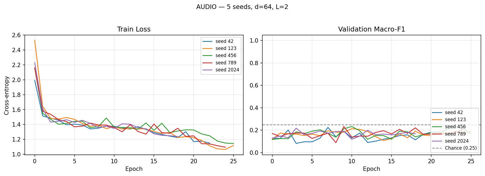
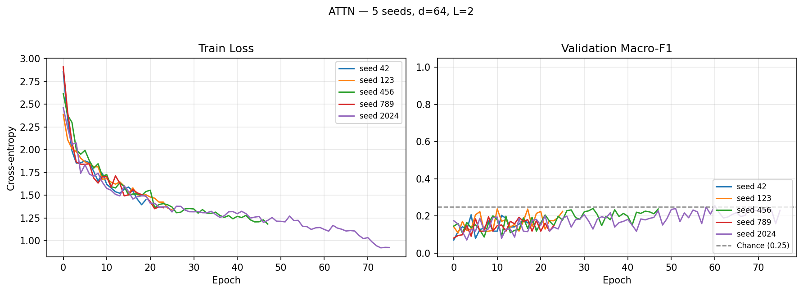
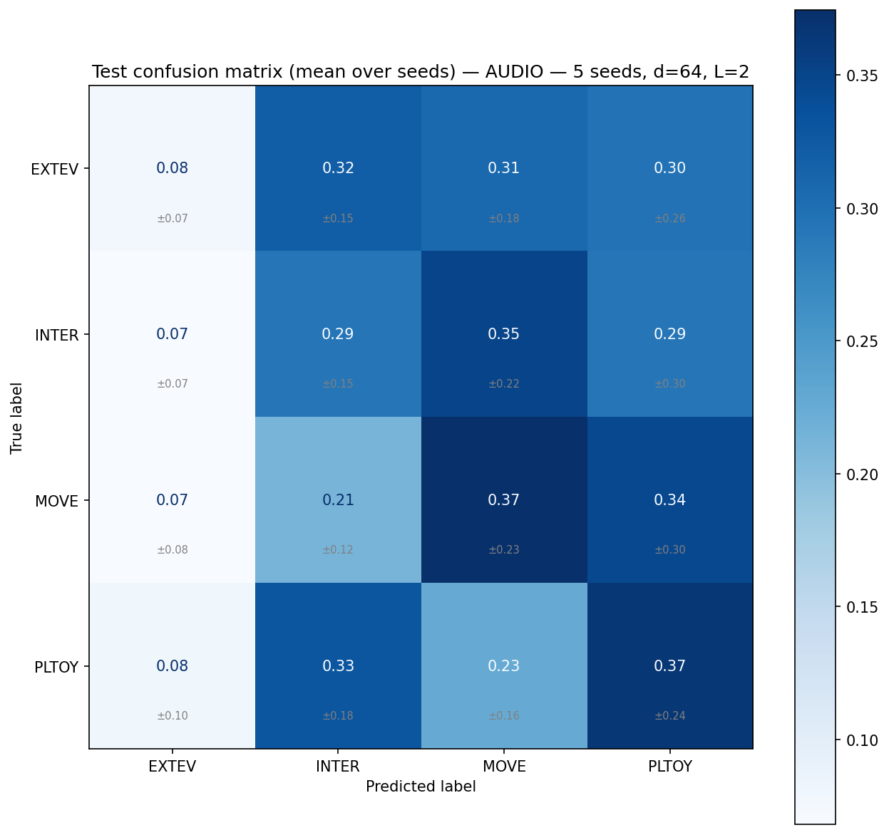
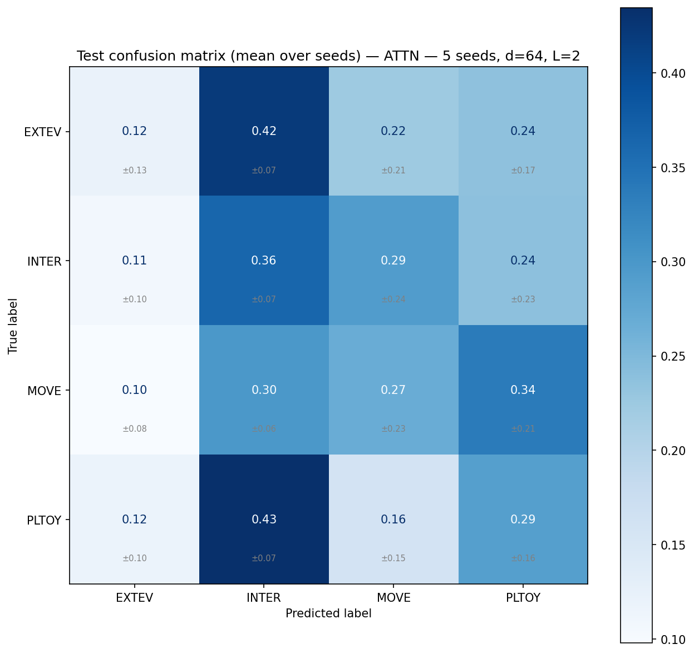
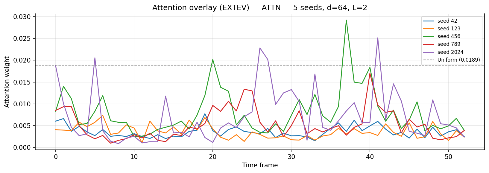

# aml2026-group-05 — Child Vocalisation Context Classification

Results and model checkpoints are saved on SwitchDrive:
- **Project data & inputs**: https://drive.switch.ch/index.php/s/c3PtXCu4gbGut9y
- **Results archive**: https://drive.switch.ch/index.php/s/NRK9nN0yo6g2n3I

---

## Problem Setting

We formulate the task as a **4-class supervised classification** problem. Each
example is a short child vocalisation clip with an associated context label and
limited metadata. The goal is to learn a classifier:

    f(x_audio, x_meta) = y

where `x_audio` is an acoustic representation (mel spectrogram), `x_meta` is a
metadata vector (age, gender), and `y` is the target context label.

### Label Space

| Label | Meaning |
|---|---|
| **PLTOY** | Playing with toys |
| **MOVE** | Movement activity |
| **INTER** | Social interaction |
| **EXTEV** | External event |

Labels are provided directly in the dataset CSV in 4-class format — no mapping needed.

---

## Dataset

| Property | Value |
|---|---|
| Total clips | 1009 |
| Class distribution | INTER=325, PLTOY=240, EXTEV=222, MOVE=222 |
| Children | 9 (child_1 … child_9) |
| Languages | Shipibo (313), Tagalog (414), Vietnamese (282) |
| Ages | 8–12 months, 5 unique values across 9 children |
| Gender | M/F, 2 unique values across 9 children |
| Mean clip duration | 1.33 s (std=0.71, max=8.01) |

**Metadata viability**: age has 5 unique values and gender has 2 unique values
across 9 children — neither is collinear with participant identity.
External metadata query is therefore safe to use in Model 3 (`USE_EXTERNAL_META = True`).

---

## Three Models

| # | Model | Script | Status |
|---|---|---|---|
| 1 | Logistic Regression (MFCC features) | `train_lr_baseline.py` | ⏳ In progress (group mate) |
| 2 | Audio-only Transformer (mean pooling) | `train_transformer_audio.py` | ✅ Done (5 seeds) |
| 3 | Attentive Pooling Transformer | `train_transformer_attn.py` | ✅ Done (5 seeds) |

### Model 1 — Logistic Regression
MFCC summary features: mean and std of each of the 20 MFCC coefficients
over time → 40-dimensional vector per clip. Input: `MFCC_Full_Raw_20_nico_.csv`
(1009 rows, shape (20, T) per clip). Regularisation strength C tuned on
validation macro-F1.

### Model 2 — Audio-only Transformer
Transformer encoder over spectrogram frames → masked mean pooling → classifier.
Architecture: `input_proj(128→64) + TransformerEncoder(d=64, heads=4, L=2) +
mean_pool + Linear(64→4)`. 126,404 parameters.

### Model 3 — Attentive Pooling Transformer
Same encoder as Model 2 but replaces mean pooling with metadata-query attentive
pooling. Age and gender are projected to a query vector that attends over
frame-level representations. Query mode: **external metadata**
(`USE_EXTERNAL_META = True` — 9 participants, age/gender not collinear with identity).
126,725 parameters.

The attention scoring uses an unscaled dot product between the metadata query
and each frame embedding, with a single learned temperature scalar (`log_tau`,
init 0 → τ=1) applied before the softmax. An earlier version used scaled
dot-product (÷√d) and a Tanh activation on the metadata projection, which
collapsed the attention distribution to near-uniform at initialisation
(mean_weight_std ≈ 0.00086 vs uniform proxy 0.00659). The current scoring
restores usable dynamic range; see `models.py` for the full rationale.

---

## Evaluation Protocol

With 9 participants the pipeline uses **participant-disjoint holdout**:

| Split | Child | N |
|---|---|---|
| Test | child_6 | 269 |
| Val | child_2 | 171 |
| Train | child_1, 3, 4, 5, 7, 8, 9 | 569 |

Children are assigned by size so the two largest (most class-balanced) go to
test and val. Leakage checks verify no participant appears in multiple splits.

**Metric**: macro-F1 (unweighted mean of per-class F1 scores). Chance level = **0.25** (4 classes).

**Multi-seed reporting**: every reported number for Models 2 and 3 is the mean
± std across 5 random seeds (42, 123, 456, 789, 2024). A single-seed point
estimate on n_test = 269 is not a defensible measurement of macro-F1, and the
seed-to-seed σ on this task is approximately 0.027 — large enough that any
single-seed comparison between models is dominated by sampling noise.

---

## Project Structure

```
aml2026-group-05/
├── src/
│   ├── config.py          ← all paths, constants, hyperparameters
│   ├── data_utils.py      ← master table, PNG loader, splits, datasets
│   ├── models.py          ← AudioTransformer + AttentivePoolingTransformer
│   └── train_utils.py     ← training loop (bf16 amp), evaluation, sanity checks
└── scripts/
    ├── generate_spectrograms.py   ← generate grayscale PNGs from denoised WAVs
    ├── train_transformer_audio.py ← Model 2 entry point
    ├── train_transformer_attn.py  ← Model 3 entry point
    ├── train_multiseed.py         ← multi-seed wrapper for Models 2 and 3
    └── train_lr_baseline.py       ← Model 1 entry point (in progress)
```

**RenkuLab path layout:**
```
DATA_DIR = /home/renku/work/aml-project/training_data/   ← Input data
  ├── denoised_audios/            ← audio_0000.wav … audio_1008.wav (denoised)
  ├── contextsvocs_groupproject_2026-04-09_104847.csv  ← ACTIVE CSV
  ├── mfccs_070426.csv            ← MFCC features (for Model 1)
  └── MFCC_Full_Raw_20_nico_.csv  ← MFCC features, 20 coefficients (for Model 1)

RES_DIR = /home/renku/work/data/   ← Results
  ├── spectrograms/   ← 1009 grayscale PNGs, 128×T px (from denoised audio)
  ├── splits/         ← train.csv (n=569), val.csv (n=171), test.csv (n=269)
  ├── models/         ← checkpoints (.pt)
  ├── results/        ← JSON metrics
  └── figures/        ← training curves + confusion matrices
```

---

## Setup

```bash
pip install -r requirements.txt
```

Hardware: results below were produced on an NVIDIA A10 (8 GB VRAM) with
PyTorch 2.4 + CUDA 12.1, using bf16 mixed precision. The models also run on
CPU but ~50× slower.

---

## Running the Models

### Step 0 — Generate spectrograms (run once)

```bash
python scripts/generate_spectrograms.py
python scripts/generate_spectrograms.py --skip_existing  # safe re-run
```

Produces clean grayscale mel spectrogram PNGs (128 mel bins × T frames, no axes,
no labels).

### Step 1 — Train Model 2 (single seed)

```bash
python scripts/train_transformer_audio.py --use_existing_splits
```

### Step 2 — Train Model 3 (single seed)

```bash
python scripts/train_transformer_attn.py --use_existing_splits
```

### Step 3 — Multi-seed runs (the way results below were produced)

```bash
python scripts/train_multiseed.py --model audio --seeds 42 123 456 789 2024 --use_existing_splits
python scripts/train_multiseed.py --model attn  --seeds 42 123 456 789 2024 --use_existing_splits
```

The multi-seed wrapper produces an aggregated JSON, an overlay of training
curves across seeds, averaged confusion matrices for val and test, and
(for Model 3) an attention-weight overlay on a fixed val example across seeds.

### Step 4 — Train Model 1 (in progress, group mate)

```bash
python scripts/train_lr_baseline.py
```

Uses the same holdout splits as Models 2 and 3.

---

## Hyperparameter Presets

| Preset | d_model | layers | dropout | lr | batch | When to use |
|---|---|---|---|---|---|---|
| `full` | 64 | 2 | 0.3 | 1e-3 | 64 | 300+ training examples — current |

Per the problem setting, the tunable hyperparameters for the Transformers are
number of layers, hidden dimension, dropout, and learning rate. A grid search
over these is planned but not yet executed.

---

## Current Results

**Protocol**: participant-disjoint holdout — Train: 7 children (n=569),
Val: child_2 (n=171), Test: child_6 (n=269). Chance = 0.25 (4 classes).
All Transformer numbers are mean ± std across 5 seeds.

### Head-to-head comparison (5 seeds × 2 models)

| Model | Val macro-F1 | Test macro-F1 | Δ vs chance |
|---|---|---|---|
| 1 — Logistic Regression | TBD | TBD | TBD |
| 2 — Audio Transformer (mean pool) | 0.224 ± 0.008 | **0.231 ± 0.027** | −0.019 |
| 3 — Attentive Pooling (metadata query) | 0.227 ± 0.022 | **0.224 ± 0.027** | −0.026 |

**Difference between Models 2 and 3**: Δ = 0.007, pooled σ ≈ 0.038, |Δ|/σ ≈ 0.18.
The two architectures are statistically indistinguishable at this data scale
(see Interpretation below).

### Per-class TEST macro-F1, Model 2 (5 seeds)

| Class | Mean | Std |
|---|---|---|
| EXTEV | 0.092 | 0.074 |
| INTER | 0.270 | 0.077 |
| MOVE | 0.231 | 0.129 |
| PLTOY | 0.332 | 0.129 |

### Per-class TEST macro-F1, Model 3 (5 seeds)

| Class | Mean | Std |
|---|---|---|
| EXTEV | 0.111 | 0.117 |
| INTER | 0.312 | 0.032 |
| MOVE | 0.173 | 0.130 |
| PLTOY | 0.300 | 0.076 |

---

### Training curves overlay (5 seeds)

**Model 2 — Audio Transformer:**



**Model 3 — Attentive Pooling Transformer:**



For both models, train loss decreases steadily but validation macro-F1
plateaus around 0.20–0.25 across all seeds and rarely crosses the chance line.
This is the diagnostic signature of cross-participant overfitting: the encoder
learns to fit the 7 training children's acoustic idiosyncrasies but those
features do not generalise to the held-out child.

### Test confusion matrices (5 seeds, mean ± std per cell)

**Model 2:**



**Model 3:**



Both models systematically under-predict EXTEV and over-predict INTER. The
class confusion patterns are visually similar between the two models —
consistent with the statistical conclusion that they are not distinguishable
at this data scale.

### Attention weight diagnostic (Model 3, 5 seeds, EXTEV class)



Each line is the attention profile of one trained seed on the same val example
of the EXTEV class. Four of five seeds produced essentially flat distributions
(max weight well below the uniform reference of 0.0189). One seed (2024)
developed clearly non-uniform focus with peaks above the uniform line — and
that same seed also achieved the only above-chance test F1 of the run (0.274).
This suggests the attention mechanism *can* learn discriminative focus when
optimisation finds the right basin, but does not do so reliably with 569
training examples.

---

## Interpretation

**The two Transformer architectures are statistically indistinguishable.**
Across 5 seeds each, Model 2 (mean pool) achieves test macro-F1 = 0.231 ± 0.027
and Model 3 (metadata-query attentive pooling) achieves 0.224 ± 0.027. The
difference is 0.007, well inside one standard deviation. We cannot reject the
null hypothesis that mean pooling and metadata-query attentive pooling are
equivalent for this task at this data scale.

**Both models sit slightly below chance on test.** Mean test F1 of 0.231 and
0.224 are both below the 4-class chance level of 0.250. Single seeds
occasionally cross chance (best seed for Model 2: 0.267; best seed for
Model 3: 0.274), but the average performance is consistent with "not learning
class-discriminative features that generalise across speakers".

**Why Model 3 does not beat Model 2.** The attention weight overlay above
shows that 4 of 5 seeds collapsed the metadata query to a near-uniform focus
distribution. With only 569 training examples distributed across 4 classes
and 7 distinct acoustic profiles, the metadata-projection parameters receive
insufficient gradient signal to develop a reliable preference for specific
temporal regions. When the optimisation does find a non-uniform solution
(seed 2024), the model crosses chance — but this happens only 1 in 5 times
and is not the typical outcome.

**Why both models hover near chance.** The task is participant-disjoint
generalisation in an under-resourced multilingual setting. The model trains
on 7 children and is tested on one completely unseen child (child_6). Each
child has a unique vocal tract, recording environment, and language background.
The training curves show classic overfitting: train loss drops steadily while
validation F1 stalls. The model memorises training children rather than
learning generalisable context cues. This is an honest, expected outcome given
the experimental constraints.

**EXTEV is consistently the hardest class** for both models. Model 2 mean F1
on EXTEV = 0.092 ± 0.074, Model 3 = 0.111 ± 0.117. EXTEV is the most
acoustically heterogeneous category — it covers reactions to a wide range of
external stimuli (food, rest, sleep) with no consistent acoustic signature in
the child's own vocalisation.

---

## Key Design Decisions

**Participant-disjoint evaluation** — prevents the model exploiting
speaker-specific acoustic cues. Children are assigned to splits once and
never moved.

**Macro-F1 metric** — equally penalises poor recall on any class. Accuracy
would be misleading as predicting INTER on every example gives ~30% accuracy
but near-zero utility.

**No child ID as feature** — direct identity creates leakage in
participant-disjoint evaluation and violates participant privacy. Age and
gender are used instead, verified non-collinear with identity.

**Multi-seed reporting (n=5)** — every Transformer result is mean ± std across
5 seeds. Single-seed comparisons on n_test = 269 are dominated by sampling
noise (σ ≈ 0.027) and are not used to draw conclusions.

**Grayscale spectrograms from denoised audio** — clean acoustic content only
(no axes or colorbar pixels). Generated at native mel resolution (128 mel bins
× T frames) and resized to 128×230 inside the dataset. Denoising reduces
background noise before feature extraction.

**F_DIM=128, MAX_LEN=230** — the model processes 128 mel bins × 230 time frames,
matching actual acoustic resolution. Attention cost is O(230²) = 52,900 pairs
per layer — significantly cheaper than reading full 1000×400 images.

**bf16 mixed precision on GPU** — bf16 has fp32 dynamic range (no GradScaler
needed) and is natively supported on the A10. Halves activation memory and
gives ~1.5–2× throughput on this model.

**RAM-cached spectrograms** — the entire dataset (~120 MB total at this
resolution) is preloaded into a single tensor at dataset construction. Per-epoch
training has zero file I/O. This was originally a fix for a hang triggered by
PIL file-handle accumulation on repeated PNG opens, but it also speeds up
training noticeably.
