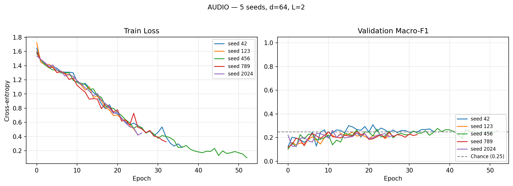
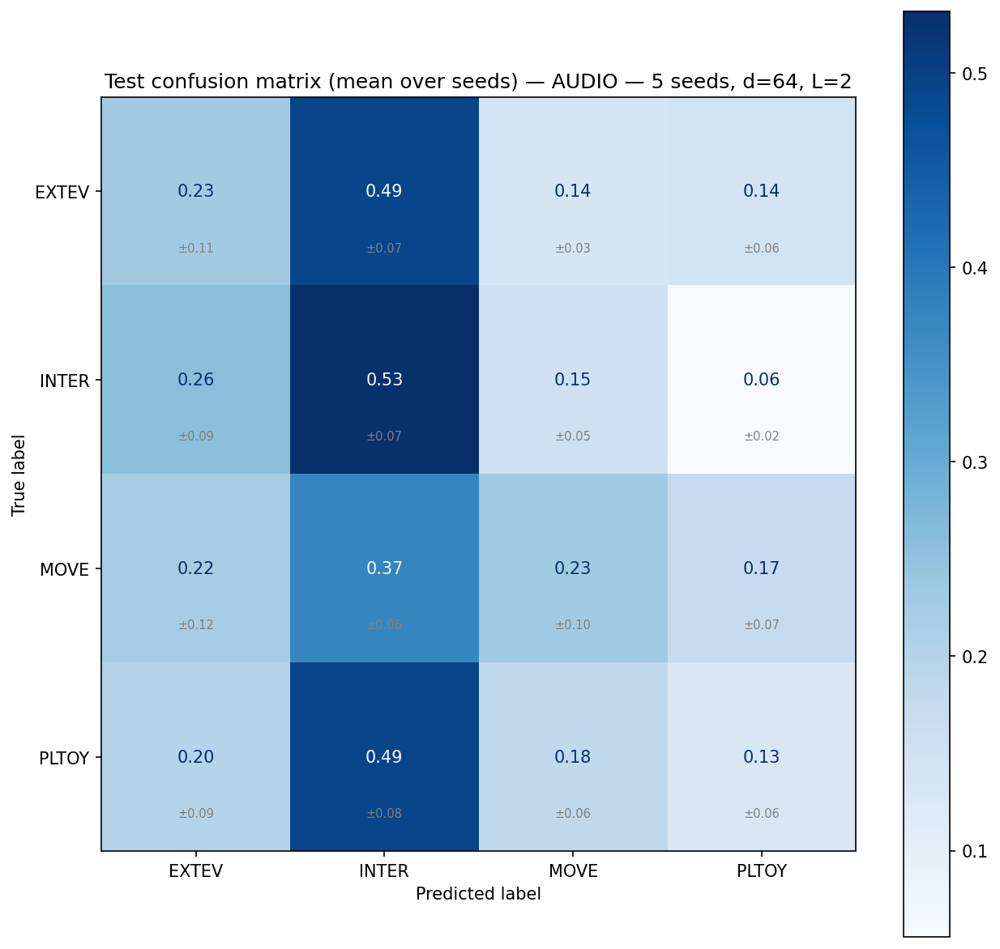
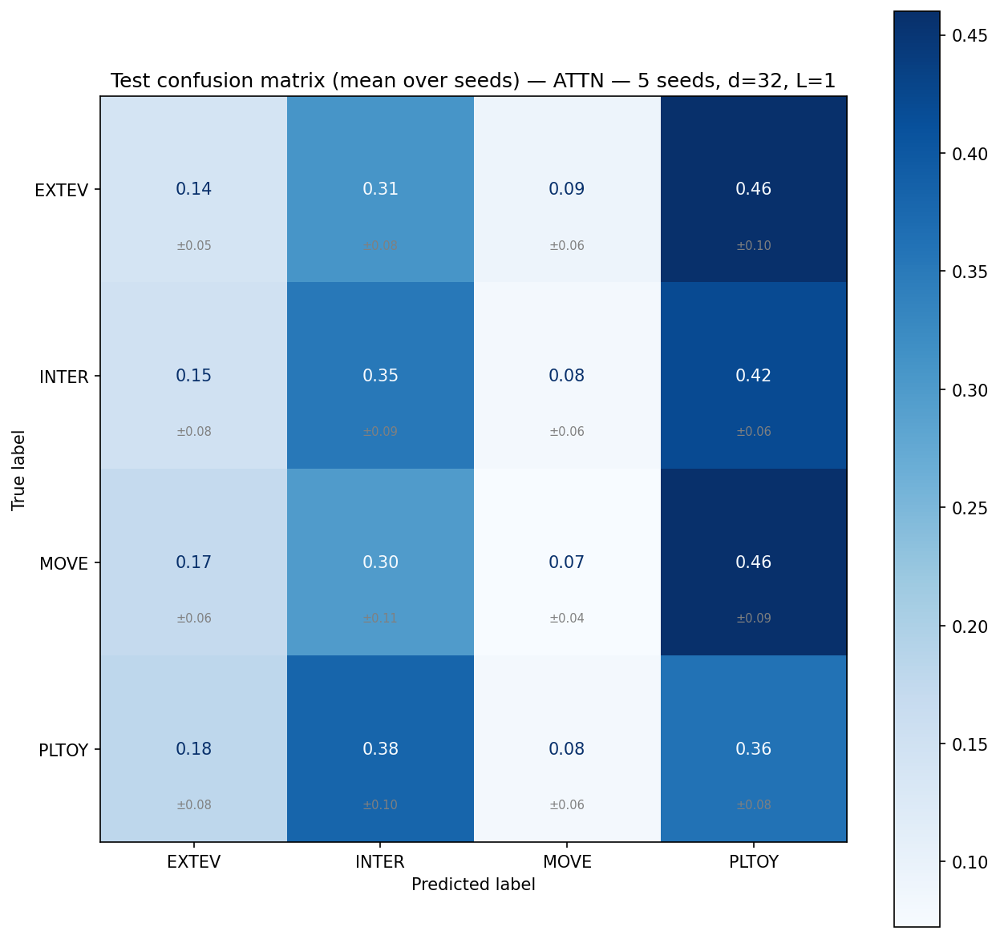

# aml2026-group-05 — Child Vocalisation Context Classification

Results and model checkpoints are saved on SwitchDrive:
- **Project data & inputs**: https://drive.switch.ch/index.php/s/c3PtXCu4gbGut9y
- **Results archive**: https://drive.switch.ch/index.php/s/NRK9nN0yo6g2n3I

---

## Problem Setting

We formulate the task as a **4-class supervised classification** problem. Each example is a short child vocalisation clip with an associated context label and limited metadata. The goal is to learn `f(x_audio, x_meta) = y` where `x_audio` is a mel spectrogram, `x_meta` is `[age, gender]`, and `y ∈ {EXTEV, INTER, MOVE, PLTOY}`.

| Label | Meaning |
|---|---|
| **PLTOY** | Playing with toys |
| **MOVE** | Movement activity |
| **INTER** | Social interaction |
| **EXTEV** | External event |

---

## Dataset

| Property | Value |
|---|---|
| Total clips | 1009 |
| Class distribution | INTER=325, PLTOY=240, EXTEV=222, MOVE=222 |
| Children | 9 |
| Languages | Shipibo (313), Tagalog (414), Vietnamese (282) |
| Ages | 8–12 months, 5 unique values across 9 children |
| Gender | M/F, 2 unique values |
| Mean clip duration | 1.33 s |

**Metadata viability**: 5 unique ages and 2 unique genders across 9 children — neither is collinear with participant identity, so the metadata query in Model 3 is safe to use (`USE_EXTERNAL_META = True`).

---

## Three Models

| # | Model | Status |
|---|---|---|
| 1 | Logistic Regression (MFCC features) | ⏳ In progress |
| 2 | Audio-only Transformer (mean pooling) | ✅ Done |
| 3 | Attentive Pooling Transformer (metadata query) | ✅ Done |

**Model 2** — `input_proj(128→d)` → `TransformerEncoder(d, heads=4, L)` → masked mean pool → `Linear(d→4)`.

**Model 3** — same encoder, replaces mean pooling with metadata-query attentive pooling. Age and gender are projected to a query vector that attends over frame embeddings via unscaled dot product, with a learned temperature scalar (`log_tau`, init 0 → τ=1) before softmax.

---

## Evaluation Protocol

**Participant-disjoint holdout** with 9 children:

| Split | Child | N |
|---|---|---|
| Test | child_6 | 269 |
| Val | child_2 | 171 |
| Train | child_1, 3, 4, 5, 7, 8, 9 | 569 |

**Metric**: macro-F1 (chance = 0.25 for 4 classes).

**Multi-seed reporting**: every Transformer number is mean ± std across 5 seeds (42, 123, 456, 789, 2024). σ_seed ≈ 0.02 on this task — single-seed comparisons are dominated by noise and are not used to draw conclusions.

---

## Hyperparameter Selection

Per the problem setting, we tuned `num_layers`, `d_model`, `dropout`, and `lr` via grid search over 8 configurations, selecting on validation macro-F1. Grid search was run with preprocessing enabled (`USE_PER_CLIP_NORM=True`, `USE_SPECAUGMENT=True`).

### Model 2 — AudioTransformer grid (sorted by val F1)

| d_model | layers | dropout | lr | Val F1 |
|---|---|---|---|---|
| **64** | **2** | **0.5** | **1e-3** | **0.306** ← selected |
| 64 | 2 | 0.3 | 5e-4 | 0.302 |
| 128 | 2 | 0.3 | 5e-4 | 0.300 |
| 64 | 2 | 0.3 | 1e-3 | 0.300 |
| 32 | 1 | 0.3 | 1e-3 | 0.280 |
| 128 | 3 | 0.3 | 5e-4 | 0.280 |
| 32 | 1 | 0.5 | 1e-3 | 0.279 |
| 128 | 3 | 0.5 | 5e-4 | 0.266 |

The top 4 configs are within 0.006 of each other — all d=64, L=2. The grid confirms the architecture; higher dropout (0.5 vs 0.3) gives a marginal edge.

### Model 3 — AttentivePooling grid (sorted by val F1)

| d_model | layers | dropout | lr | Val F1 |
|---|---|---|---|---|
| **32** | **1** | **0.3** | **1e-3** | **0.286** ← selected |
| 128 | 3 | 0.3 | 5e-4 | 0.254 |
| 64 | 2 | 0.5 | 1e-3 | 0.250 |
| 64 | 2 | 0.3 | 1e-3 | 0.245 |
| 64 | 2 | 0.3 | 5e-4 | 0.229 |
| 32 | 1 | 0.5 | 1e-3 | 0.222 |
| 128 | 2 | 0.3 | 5e-4 | 0.219 |
| 128 | 3 | 0.5 | 5e-4 | 0.218 |

The smallest model (d=32, L=1, 26K params) won by a clear margin (+0.032 over the next). With attentive pooling, a simpler encoder overfits less — suggesting the attention mechanism itself adds enough capacity that the encoder should be kept minimal.

---

## Project Structure

```
aml2026-group-05/
├── src/
│   ├── config.py          ← paths, hyperparameters, augmentation flags
│   ├── data_utils.py      ← splits, RAM-cached datasets, per-clip norm, SpecAugment
│   ├── models.py          ← AudioTransformer + AttentivePoolingTransformer
│   └── train_utils.py     ← training loop (bf16 amp), evaluation, sanity checks
└── scripts/
    ├── generate_spectrograms.py
    ├── train_transformer_audio.py    ← Model 2 entry point + grid search
    ├── train_transformer_attn.py     ← Model 3 entry point + grid search
    ├── train_multiseed.py            ← multi-seed wrapper for Models 2 and 3
    └── train_lr_baseline.py          ← Model 1 entry point (in progress)
```

---

## Running the Models

```bash
# Generate spectrograms (run once)
python scripts/generate_spectrograms.py

# Grid search (selects best config on val F1)
python scripts/train_transformer_audio.py --grid_search --use_existing_splits
python scripts/train_transformer_attn.py  --grid_search --use_existing_splits

# Final multi-seed runs with grid-selected configs
python scripts/train_multiseed.py --model audio --seeds 42 123 456 789 2024 --use_existing_splits \
    --d_model 64 --num_layers 2 --dropout 0.5 --lr 0.001 --batch_size 32
python scripts/train_multiseed.py --model attn --seeds 42 123 456 789 2024 --use_existing_splits \
    --d_model 32 --num_layers 1 --dropout 0.3 --lr 0.001 --batch_size 16
```

---

## Results

**Protocol**: participant-disjoint holdout. All Transformer numbers are mean ± std across 5 seeds. Chance = 0.25.

### Final reported numbers (grid-selected hyperparameters)

| Model | Config | Params | Val F1 | Test F1 |
|---|---|---|---|---|
| 1 — Logistic Regression | TBD | TBD | TBD | TBD |
| **2 — Audio Transformer** | d=64, L=2, drop=0.5 | 126K | 0.270 ± 0.022 | **0.249 ± 0.020** |
| **3 — Attentive Pooling** | d=32, L=1, drop=0.3 | 26K | 0.252 ± 0.045 | **0.221 ± 0.013** |
| Chance | — | — | 0.250 | 0.250 |

**Δ Model 2 vs Model 3**: +0.028, pooled σ ≈ 0.024, |Δ|/σ ≈ 1.2 — within noise. The two architectures remain statistically indistinguishable.

### Preprocessing ablation (FULL preset: d=64, L=2, drop=0.3)

| Model | Preprocessing | Val F1 | Test F1 | Val→Test gap |
|---|---|---|---|---|
| 2 — Audio Transformer | raw | 0.224 ± 0.008 | 0.231 ± 0.027 | −0.003 |
| 2 — Audio Transformer | norm + SpecAugment | 0.288 ± 0.017 | 0.228 ± 0.007 | +0.060 |
| 3 — Attentive Pooling | raw | 0.227 ± 0.022 | 0.224 ± 0.027 | +0.003 |
| 3 — Attentive Pooling | norm + SpecAugment | 0.239 ± 0.028 | 0.213 ± 0.025 | +0.026 |

Preprocessing lifts val F1 but not test F1 — the val→test gap widens from ≈0 to +0.06. This is the key diagnostic: inter-child variance, not feature quality, is the bottleneck.

### Per-class TEST macro-F1 (grid-selected configs)

| Class | Model 2 | Model 3 |
|---|---|---|
| EXTEV | 0.194 ± 0.072 | 0.147 ± 0.043 |
| INTER | 0.401 ± 0.021 | 0.318 ± 0.044 |
| MOVE | 0.220 ± 0.074 | 0.093 ± 0.045 |
| PLTOY | 0.183 ± 0.084 | 0.326 ± 0.036 |

INTER is the strongest class for both models. EXTEV and MOVE are the weakest — both are acoustically heterogeneous categories where the child's vocalisation carries little class-specific information.

---

### Training curves (grid-selected configs, 5 seeds)

<p align="center">
  
  
</p>

<p align="center">
  <strong>Left:</strong> Model 2 (d=64, L=2, drop=0.5) — trains 25–53 epochs; val F1 oscillates around chance. &nbsp;&nbsp;
  <strong>Right:</strong> Model 3 (d=32, L=1, drop=0.3) — early-stops within 16–21 epochs; val F1 peaks in first 2–6 epochs then degrades.
</p>

The contrast between the two panels is the clearest visual summary of the project's finding. Model 2 overfits slowly (train loss drops while val F1 stays flat). Model 3 converges and overfits fast (the tiny encoder learns what it can in a few epochs and then drifts). Neither model finds a regime where continued training improves generalisation — the classic signature of a data-limited, cross-participant task.

---

### Test confusion matrices (grid-selected configs, 5 seeds)

<p align="center">
  
  
</p>

<p align="center">
  <strong>Left:</strong> Model 2 &nbsp;&nbsp;&nbsp;
  <strong>Right:</strong> Model 3
</p>

Model 2 collapses heavily onto INTER (predicts INTER for the majority of EXTEV, INTER, and PLTOY examples). Model 3 distributes predictions more evenly but remains biased toward PLTOY. Neither matrix shows a strong diagonal — neither model has learned class-specific features that survive the participant shift.

---

## Interpretation

**The two Transformer architectures are statistically indistinguishable.** After grid-based hyperparameter selection and 5-seed evaluation, Model 2 achieves test F1 = 0.249 ± 0.020 and Model 3 achieves 0.221 ± 0.013. The difference (|Δ|/σ ≈ 1.2) is within noise. We cannot reject the null hypothesis that mean pooling and metadata-query attentive pooling are equivalent at this data scale.

**Hyperparameter tuning did not break the ceiling.** The grid search explored architectures from 26K to 648K parameters. Model 2's best config landed at chance on test (0.249 vs 0.250). Model 3's best config (d=32, L=1) is 5× smaller than the default preset and still below chance. No configuration exceeded chance by a meaningful margin.

**Preprocessing helped val but not test.** Per-clip normalisation and SpecAugment lifted Model 2 val from 0.224 to 0.288 (+0.064) but test F1 did not move (0.231 → 0.228). The val→test gap widened from ≈0 to +0.06. This directly demonstrates that **inter-child variance is the dominant source of test error**, not input representation quality.

**The grid search picked different architectures for each model — and this is informative.** Model 2's best is d=64 L=2 with higher dropout; Model 3's best is d=32 L=1 (5× fewer parameters). The attentive pooling mechanism adds enough model capacity that the encoder should be kept minimal. Despite this, neither model generalises to the unseen test child.

**EXTEV is consistently the hardest class** (mean test F1 ≈ 0.15–0.19). It covers reactions to diverse external stimuli with no consistent acoustic signature.

**Implication for the experimental design.** The combination of only 7 training children, only 1 held-out test child, and ~570 training examples is too restrictive for any architecture or preprocessing strategy to achieve reliable above-chance generalisation. A fairer test of the architectural question would require more participants or pretrained audio representations — neither of which is permitted under the strict problem setting.

---

## Key Design Decisions

**Evaluation protocol** — The 9 children contributed very uneven amounts of data (11 to 269 clips each), so an exact 70/15/15 split by clip count was not achievable under the participant-disjoint constraint. To keep evaluation participant-disjoint and still ensure all 4 classes appear in every split, the two largest and most class-balanced children were assigned to test and val. This yields a 56/17/27 clip-count ratio instead of a perfect 70/15/15. The deviation is documented and justified: any participant-disjoint split of 9 unequal-sized children cannot exactly match the target ratio, and using smaller children for held-out splits would risk missing entire classes.

**Macro-F1 metric** — equally penalises poor recall on any class. Accuracy would be misleading because predicting INTER for everything yields ~30% accuracy.

**No child ID as feature** — direct identity creates leakage and violates participant privacy. Age and gender are used instead, verified non-collinear with identity.

**Multi-seed reporting (n=5)** — every Transformer result is mean ± std across 5 seeds. Single-seed comparisons on n_test = 269 are dominated by sampling noise.

**Hyperparameter selection on val only** — the grid search ranked 8 configurations by val macro-F1. The grid-selected config was then retrained with 5 seeds for the final reported test number. Test was not used for model selection.

**Per-clip normalisation + SpecAugment as opt-in ablation** — toggled by `USE_PER_CLIP_NORM` and `USE_SPECAUGMENT` in `config.py`. The ablation results demonstrate that preprocessing helps val but not test.

**Grayscale spectrograms from denoised audio** — clean acoustic content only (no axes or colorbar pixels). Native mel resolution (128 mel bins × T frames), resized to 128 × 230 inside the dataset.


