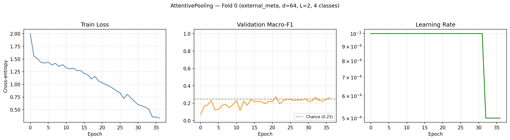
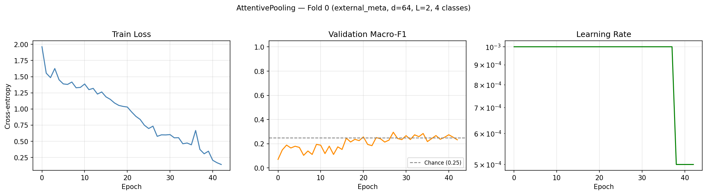

# aml2026-group-05 — Child Vocalisation Context Classification

Results and model checkpoints are saved on SwitchDrive:
- **Project data & inputs**: https://drive.switch.ch/index.php/s/c3PtXCu4gbGut9y
- **Results archive**: https://drive.switch.ch/index.php/s/NRK9nN0yo6g2n3I

---

## Problem Setting

We formulate the task as a **4-class supervised classification** problem. Each
example is a short child vocalisation clip with an associated context label and
limited metadata. The goal is to learn a classifier:

    f(x_audio, x_meta) = y

where `x_audio` is an acoustic representation (mel spectrogram), `x_meta` is a
metadata vector (age, gender), and `y` is the target context label.

### Label Space

| Label | Meaning |
|---|---|
| **PLTOY** | Playing with toys |
| **MOVE** | Movement activity |
| **INTER** | Social interaction |
| **EXTEV** | External event |

Labels are provided directly in the dataset CSV in 4-class format — no mapping needed.

---

## Dataset

**Active CSV**: `contextsvocs_groupproject_2026-04-09_104847.csv`

| Property | Value |
|---|---|
| Total clips | 1009 |
| Class distribution | INTER=325, PLTOY=240, EXTEV=222, MOVE=222 |
| Children | 9 (child_1 … child_9) |
| Languages | Shipibo (313), Tagalog (414), Vietnamese (282) |
| Ages | 8–12 months, 5 unique values across 9 children |
| Gender | M/F, 2 unique values across 9 children |
| Mean clip duration | 1.33 s (std=0.71, max=8.01) |

**Metadata viability**: age has 5 unique values and gender has 2 unique values
across 9 children — neither is collinear with participant identity.
External metadata query is therefore safe to use in Model 3 (`USE_EXTERNAL_META = True`).

---

## Three Models

| # | Model | Script | Status |
|---|---|---|---|
| 1 | Logistic Regression (MFCC features) | `train_lr_baseline.py` | ❌ Not yet built |
| 2 | Audio-only Transformer (mean pooling) | `train_transformer_audio.py` | ✅ Done |
| 3 | Attentive Pooling Transformer | `train_transformer_attn.py` | ✅ Done |

### Model 1 — Logistic Regression
MFCC summary features: mean and std of each of the 20 MFCC coefficients
over time → 40-dimensional vector per clip. Input: `MFCC_Full_Raw_20_nico_.csv`
(1009 rows, shape (20, T) per clip). Regularisation strength C tuned on
validation macro-F1.

### Model 2 — Audio-only Transformer
Transformer encoder over spectrogram frames → masked mean pooling → classifier.
Architecture: `input_proj(128→64) + TransformerEncoder(d=64, heads=4, L=2) +
mean_pool + Linear(64→4)`. 126,404 parameters.

### Model 3 — Attentive Pooling Transformer
Same encoder as Model 2 but replaces mean pooling with metadata-query attentive
pooling. Age and gender are projected to a query vector that attends over
frame-level representations. Query mode: **external metadata**
(`USE_EXTERNAL_META = True` — 9 participants, age/gender not collinear with identity).
126,724 parameters.

---

## Evaluation Protocol

With 9 participants the pipeline uses **participant-disjoint holdout**:

| Split | Child | N |
|---|---|---|
| Test | child_6 | 269 |
| Val | child_2 | 171 |
| Train | child_1, 3, 4, 5, 7, 8, 9 | 569 |

Children are assigned by size so the two largest (most class-balanced) go to
test and val. Leakage checks verify no participant appears in multiple splits.

**Metric**: macro-F1 (unweighted mean of per-class F1 scores). Chance level = **0.25** (4 classes).

---

## Project Structure

```
aml2026-group-05/
├── src/
│   ├── config.py          ← all paths, constants, hyperparameters
│   ├── data_utils.py      ← master table, PNG loader, splits, datasets
│   ├── models.py          ← AudioTransformer + AttentivePoolingTransformer
│   └── train_utils.py     ← training loop, evaluation, sanity checks
└── scripts/
    ├── generate_spectrograms.py   ← generate grayscale PNGs from denoised WAVs
    ├── train_transformer_audio.py ← Model 2 entry point
    ├── train_transformer_attn.py  ← Model 3 entry point
    └── train_lr_baseline.py       ← Model 1 entry point (not yet built)
```

**RenkuLab path layout:**
```
DATA_DIR = /home/renku/work/aml-project/training_data/   ← READ ONLY
  ├── denoised_audios/            ← audio_0000.wav … audio_1008.wav (denoised)
  ├── contextsvocs_groupproject_2026-04-09_104847.csv  ← ACTIVE CSV
  ├── mfccs_070426.csv            ← MFCC features (for Model 1)
  └── MFCC_Full_Raw_20_nico_.csv  ← MFCC features, 20 coefficients (for Model 1)

RES_DIR = /home/renku/work/data/   ← READ/WRITE
  ├── spectrograms/   ← 1009 grayscale PNGs, 128×T px (from denoised audio)
  ├── splits/         ← train.csv (n=569), val.csv (n=171), test.csv (n=269)
  ├── models/         ← checkpoints (.pt)
  ├── results/        ← JSON metrics
  └── figures/        ← training curves + confusion matrices
```

---

## Setup

```bash
pip install -r requirements.txt
```

---

## Running the Models

### Step 0 — Generate spectrograms (run once)

```bash
python scripts/generate_spectrograms.py
python scripts/generate_spectrograms.py --skip_existing  # safe re-run
```

Produces clean grayscale mel spectrogram PNGs (128 mel bins × T frames, no axes,
no labels). The model loads these and resizes to F_DIM=128 × MAX_LEN=230 inside
`SpectrogramDataset.__getitem__`. Confirm the DataLoader sanity line shows:
```
Batch: x=torch.Size([32, 230, 128])   ← correct
```

### Step 1 — Train Model 2

```bash
python scripts/train_transformer_audio.py                   # first run — builds splits
python scripts/train_transformer_audio.py --use_existing_splits  # reuse splits
python scripts/train_transformer_audio.py --grid_search          # hyperparameter search
```

### Step 2 — Train Model 3

```bash
python scripts/train_transformer_attn.py \
    --baseline_test_f1 0.267 \
    --use_existing_splits
```

### Step 3 — Train Model 1 (not yet built)

```bash
python scripts/train_lr_baseline.py
```

Uses `MFCC_Full_Raw_20_nico_.csv` with the same holdout splits as Models 2 and 3.

---

## Hyperparameter Presets

| Preset | d_model | layers | batch | When to use |
|---|---|---|---|---|
| `small` | 32 | 1 | 8 | < 100 training examples |
| `full` *(default)* | 64 | 2 | 32 | 300+ training examples — current |

---

## Current Results

**Protocol**: participant-disjoint holdout — Train: 7 children (n=569),
Val: child_2 (n=171), Test: child_6 (n=269). Chance = 0.25 (4 classes).

### Model 2 — Audio-only Transformer (mean pooling)

Training curves :



| Metric | Value |
|---|---|
| Val macro-F1 | 0.265 |
| **Test macro-F1** | **0.267** |
| Δ vs chance | +0.017 |
| Val→Test gap | −0.002 ✓ |
| Epochs trained | 56 |

Per-class test F1:

| Class | Precision | Recall | F1 |
|---|---|---|---|
| EXTEV | 0.160 | 0.080 | 0.107 |
| INTER | 0.306 | 0.519 | **0.385** |
| MOVE | 0.276 | 0.447 | **0.341** |
| PLTOY | 0.441 | 0.161 | 0.236 |

---

### Model 3 — Attentive Pooling Transformer (external metadata)

Training curves :



| Metric | Value |
|---|---|
| Val macro-F1 | 0.295 |
| **Test macro-F1** | **0.240** |
| Δ vs chance | −0.010 |
| Δ vs Model 2 | −0.027 |
| Val→Test gap | +0.055 |
| Query mode | external_meta (age + gender) |
| Epochs trained | 43 |

Per-class test F1:

| Class | Precision | Recall | F1 |
|---|---|---|---|
| EXTEV | 0.269 | 0.140 | **0.184** |
| INTER | 0.321 | 0.316 | 0.318 |
| MOVE | 0.200 | 0.574 | 0.297 |
| PLTOY | 0.333 | 0.108 | 0.163 |

---

### Head-to-head comparison

| Model | Val F1 | Test F1 | Δ vs chance | Best class |
|---|---|---|---|---|
| 1 — Logistic Regression | TBD | TBD | TBD | TBD |
| 2 — Audio Transformer | 0.265 | **0.267** | +0.017 | INTER (0.385) |
| 3 — Attentive Pooling | 0.295 | 0.240 | −0.010 | INTER (0.318) |

---

## Interpretation

**Model 2 marginally beats Model 3** (0.267 vs 0.240 test macro-F1). Both are
near the 0.25 chance level, which is the expected outcome of cross-participant
generalisation with 569 training examples.

**Why Model 3 does not beat Model 2:** The attention weight statistics confirm
the metadata query produces nearly uniform weights (`mean_weight_std = 0.00086`
vs `uniform_proxy = 0.00659`). The query has not learned to focus on
discriminative temporal regions. With 569 training examples distributed across
4 classes and 9 acoustic profiles, the attention parameters receive insufficient
gradient signal to develop meaningful frame preferences. The −0.027 delta is
within noise and should not be interpreted as a fundamental failure of the
architecture — it reflects the data-limited setting.

**Why results are near chance:** The task is cross-participant generalisation
in an under-resourced language setting. The model trains on 7 children and is
tested on one completely unseen child (child_6). Each child has a unique acoustic
profile and recording environment. Both training curves show classic overfitting:
train loss drops to ~0.05–0.15 while validation F1 plateaus near 0.25–0.30. The
model memorises training children rather than learning generalisable context cues.
This is an expected and honest outcome given the experimental constraints.

**EXTEV is the hardest class** (F1 = 0.107 in Model 2, 0.184 in Model 3).
It is the most acoustically ambiguous category — external events are defined
by what is happening around the child rather than the child's own vocalisation
pattern.

---

## Key Design Decisions

**Participant-disjoint evaluation** — prevents the model exploiting
speaker-specific acoustic cues. Children are assigned to splits once and
never moved.

**Macro-F1 metric** — equally penalises poor recall on any class. Accuracy
would be misleading as predicting INTER on every example gives ~30% accuracy
but near-zero utility.

**No child ID as feature** — direct identity creates leakage in
participant-disjoint evaluation and violates participant privacy. Age and
gender are used instead, verified non-collinear with identity.

**Grayscale spectrograms from denoised audio** — clean acoustic content only
(no axes or colorbar pixels). Generated at native mel resolution (128 mel bins
× T frames) and resized to 128×230 inside the dataset. Denoising reduces
background noise before feature extraction.

**F_DIM=128, MAX_LEN=230** — the model processes 128 mel bins × 230 time frames,
matching actual acoustic resolution. Attention cost is O(230²) = 52,900 pairs
per layer — significantly cheaper than reading full 1000×400 images.
