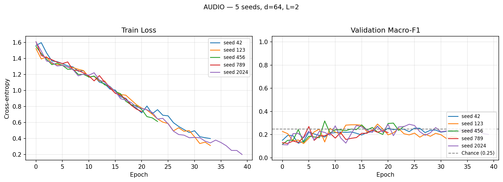
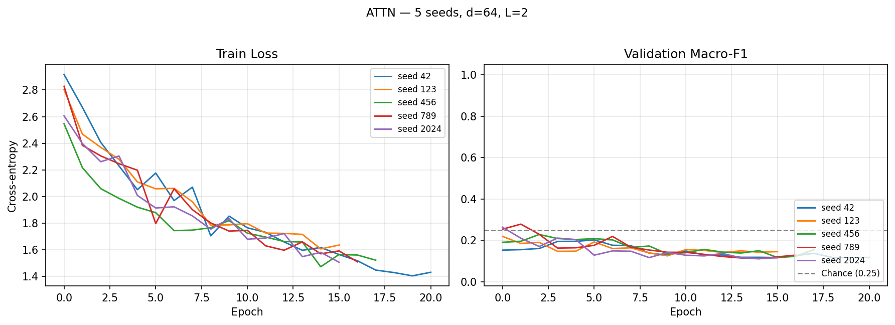
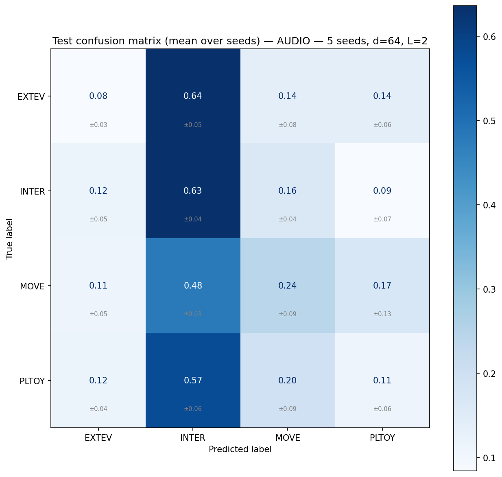
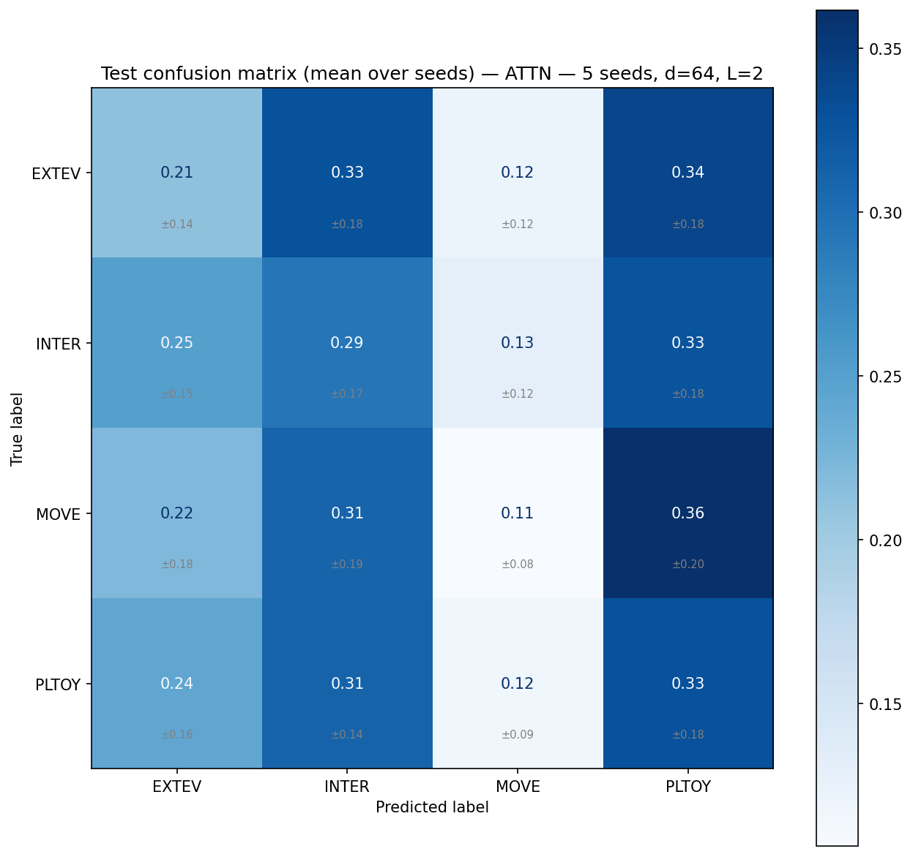
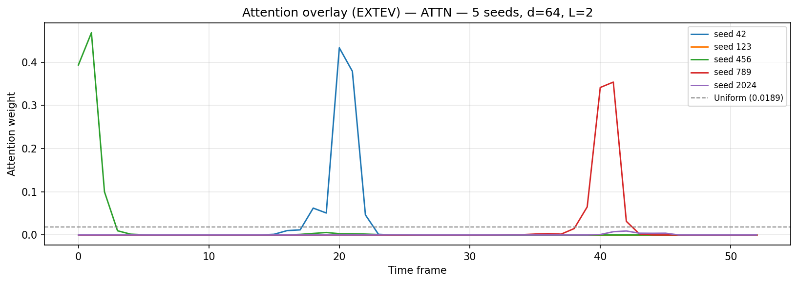

# aml2026-group-05 — Child Vocalisation Context Classification

Results and model checkpoints are saved on SwitchDrive:
- **Project data & inputs**: https://drive.switch.ch/index.php/s/c3PtXCu4gbGut9y
- **Results archive**: https://drive.switch.ch/index.php/s/NRK9nN0yo6g2n3I

---

## Problem Setting

We formulate the task as a **4-class supervised classification** problem. Each example is a short child vocalisation clip with an associated context label and limited metadata. The goal is to learn `f(x_audio, x_meta) = y` where `x_audio` is a mel spectrogram, `x_meta` is `[age, gender]`, and `y ∈ {EXTEV, INTER, MOVE, PLTOY}`.

| Label | Meaning |
|---|---|
| **PLTOY** | Playing with toys |
| **MOVE** | Movement activity |
| **INTER** | Social interaction |
| **EXTEV** | External event |

---

## Dataset

| Property | Value |
|---|---|
| Total clips | 1009 |
| Class distribution | INTER=325, PLTOY=240, EXTEV=222, MOVE=222 |
| Children | 9 |
| Languages | Shipibo (313), Tagalog (414), Vietnamese (282) |
| Ages | 8–12 months, 5 unique values across 9 children |
| Gender | M/F, 2 unique values |
| Mean clip duration | 1.33 s |

**Metadata viability**: 5 unique ages and 2 unique genders across 9 children — neither is collinear with participant identity, so the metadata query in Model 3 is safe to use (`USE_EXTERNAL_META = True`).

---

## Three Models

| # | Model | Status |
|---|---|---|
| 1 | Logistic Regression (MFCC features) | ⏳ In progress |
| 2 | Audio-only Transformer (mean pooling) | ✅ Done (5 seeds × 2 conditions) |
| 3 | Attentive Pooling Transformer (metadata query) | ✅ Done (5 seeds × 2 conditions) |

**Model 2 (126,404 params)** — `input_proj(128→64)` → `TransformerEncoder(d=64, heads=4, L=2)` → masked mean pool → `Linear(64→4)`.

**Model 3 (126,725 params)** — same encoder, replaces mean pooling with metadata-query attentive pooling. Age and gender are projected to a query vector that attends over frame embeddings via unscaled dot product, with a learned temperature scalar (`log_tau`, init 0 → τ=1) before softmax. An earlier version used `÷√d` scaling and `Tanh` on the metadata projection — that combination collapsed the attention to near-uniform at init (`mean_weight_std ≈ 0.00086` vs uniform proxy 0.00659). The current scoring restores usable dynamic range; see `models.py`.

---

## Evaluation Protocol

**Participant-disjoint holdout** with 9 children:

| Split | Child | N |
|---|---|---|
| Test | child_6 | 269 |
| Val | child_2 | 171 |
| Train | child_1, 3, 4, 5, 7, 8, 9 | 569 |

**Metric**: macro-F1 (chance = 0.25 for 4 balanced classes).

**Multi-seed reporting**: every Transformer number is mean ± std across 5 seeds (42, 123, 456, 789, 2024). σ_seed ≈ 0.025 on this task — single-seed comparisons are dominated by noise and are not used to draw conclusions.

---

## Project Structure

```
aml2026-group-05/
├── src/
│   ├── config.py          ← paths, hyperparameters, augmentation flags
│   ├── data_utils.py      ← splits, RAM-cached datasets, per-clip norm, SpecAugment
│   ├── models.py          ← AudioTransformer + AttentivePoolingTransformer
│   └── train_utils.py     ← training loop (bf16 amp), evaluation, sanity checks
└── scripts/
    ├── generate_spectrograms.py
    ├── train_transformer_audio.py    ← Model 2 entry point
    ├── train_transformer_attn.py     ← Model 3 entry point
    ├── train_multiseed.py            ← multi-seed wrapper for Models 2 and 3
    └── train_lr_baseline.py          ← Model 1 entry point (in progress)
```

---

## Running the Models

```bash
# Generate spectrograms (run once)
python scripts/generate_spectrograms.py

# Multi-seed runs — both models, both preprocessing conditions toggled in config.py
python scripts/train_multiseed.py --model audio --seeds 42 123 456 789 2024 --use_existing_splits
python scripts/train_multiseed.py --model attn  --seeds 42 123 456 789 2024 --use_existing_splits
```

Toggle preprocessing in `src/config.py`:

```python
USE_PER_CLIP_NORM = True   # per-clip mean/variance normalisation
USE_SPECAUGMENT   = True   # train-only time + frequency masking
```

Hardware: NVIDIA A10 (8 GB) with PyTorch 2.4 + CUDA 12.1, bf16 mixed precision. Each multi-seed run completes in ~5 minutes.

---

## Results

**Protocol**: participant-disjoint holdout. All Transformer numbers are mean ± std across 5 seeds. Chance = 0.25.

### Main ablation: 2 models × 2 preprocessing conditions

| Model | Preprocessing | Val macro-F1 | Test macro-F1 | Val→Test gap |
|---|---|---|---|---|
| 1 — Logistic Regression | — | TBD | TBD | TBD |
| 2 — Audio Transformer (mean pool) | raw | 0.224 ± 0.008 | **0.231 ± 0.027** | −0.003 |
| 2 — Audio Transformer (mean pool) | norm + SpecAugment | **0.288 ± 0.017** | 0.228 ± 0.007 | +0.060 |
| 3 — Attentive Pooling (metadata query) | raw | 0.227 ± 0.022 | 0.224 ± 0.027 | +0.003 |
| 3 — Attentive Pooling (metadata query) | norm + SpecAugment | 0.239 ± 0.028 | 0.213 ± 0.025 | +0.026 |

### Statistical comparisons (test macro-F1)

| Comparison | Δ | pooled σ | \|Δ\|/σ | Conclusion |
|---|---|---|---|---|
| Model 2 raw vs Model 3 raw | +0.007 | 0.038 | 0.18 | indistinguishable |
| Model 2 norm+aug vs Model 3 norm+aug | +0.015 | 0.026 | 0.58 | indistinguishable |
| Model 2 raw vs Model 2 norm+aug | −0.003 | 0.028 | 0.11 | preprocessing did not help test |
| Model 3 raw vs Model 3 norm+aug | −0.011 | 0.035 | 0.31 | preprocessing did not help test |

Every comparison sits well inside one standard deviation. The honest mean test macro-F1 across all 4 conditions is ≈ **0.224**, slightly below chance.

### Per-class TEST macro-F1, all conditions

| Class | M2 raw | M2 norm+aug | M3 raw | M3 norm+aug |
|---|---|---|---|---|
| EXTEV | 0.092 ± 0.074 | 0.104 ± 0.036 | 0.111 ± 0.117 | 0.171 ± 0.052 |
| INTER | 0.270 ± 0.077 | 0.423 ± 0.020 | 0.312 ± 0.032 | 0.257 ± 0.114 |
| MOVE  | 0.231 ± 0.129 | 0.228 ± 0.044 | 0.173 ± 0.130 | 0.114 ± 0.038 |
| PLTOY | 0.332 ± 0.129 | 0.157 ± 0.062 | 0.300 ± 0.076 | 0.308 ± 0.098 |

INTER (largest training class) is consistently strongest. EXTEV is consistently weakest. Preprocessing tightens per-seed variance noticeably (e.g. M2 EXTEV σ: 0.074 → 0.036) but does not improve the means.

---

### Training curves overlay (5 seeds)

**Model 2 — raw spectrograms:**


**Model 2 — per-clip norm + SpecAugment:**



The raw runs show train loss decreasing slowly while val F1 stays flat near 0.2. The preprocessed runs show train loss dropping much more aggressively (~1.5 → ~0.4) while val F1 climbs only modestly to ~0.25–0.30 — and test F1 does not improve. Preprocessing made the model fit the training data much better without improving generalisation: the textbook overfitting signature.

**Model 3 — per-clip norm + SpecAugment:**



Most Model 3 + preprocessing seeds early-stop within 20 epochs because val F1 peaks within the first few epochs and then degrades. The model is finding a basin quickly and then drifting off it.

---

### Test confusion matrices (5 seeds, mean ± std per cell)

<p align="center">
  
  
</p>

<p align="center">
  <strong>Left:</strong> Model 2 — preprocessed &nbsp;&nbsp;&nbsp;
  <strong>Right:</strong> Model 3 — preprocessed
</p>

Model 2 collapses heavily onto INTER (predicts INTER for ~63% of EXTEV, INTER, and PLTOY examples). Model 3 distributes its predictions more evenly across columns but remains biased toward PLTOY. Neither matrix shows a strong diagonal — neither model has learned class-specific features that survive the participant shift.

---

### Attention weight diagnostic (Model 3 + preprocessing, 5 seeds, EXTEV)



**This is the most informative single figure in the project.** After the attention fix and with preprocessing enabled, **3 of 5 seeds produce sharp, narrow attention peaks** with weights up to 0.47 — more than 25× the uniform reference (0.0189). All five seeds reach `is_non_uniform: True` with `mean_weight_std ≈ 0.035` (≈ 5× the uniform proxy). The attention mechanism is now reliably learning to focus.

But the test F1 in this exact condition is **0.213 ± 0.025** — the worst of the four conditions. The model is sharpening attention onto frames that fit the validation child but happen to hurt the test child. This cleanly separates two questions that are usually conflated:

1. *Does the attention mechanism work mechanically?* **Yes** — clearly non-uniform.
2. *Does it produce class-discriminative features that generalise?* **No** — at this data scale, sharper attention leads to worse cross-participant generalisation, not better.

---

## Interpretation

**The two Transformer architectures are statistically indistinguishable.** Across 5 seeds × 2 preprocessing conditions, every Model 2 vs Model 3 comparison has `|Δ|/σ < 0.6`. We cannot reject the null hypothesis that mean pooling and metadata-query attentive pooling are equivalent for this task at this data scale.

**Preprocessing did not help test performance.** Per-clip mean/variance normalisation and SpecAugment lifted Model 2 val from 0.224 to 0.288 (+0.064) and tightened seed-to-seed variance, but test F1 did not move (0.231 → 0.228 for Model 2; 0.224 → 0.213 for Model 3). The val→test gap widened from ≈ 0 to +0.06.

**The widening val→test gap is the key diagnostic.** It shows that the bottleneck is *not* the input representation. Better preprocessing helps the model fit the *specific* validation child more accurately, but those improvements do not transfer to the *other* held-out child. The two children differ enough that features learned to fit one do not generalise to the other. This is direct evidence that **inter-child variance is the dominant source of test error**, not feature-extraction quality or model capacity.

**The attention fix made the mechanism functional but not helpful.** The diagnostic above shows clearly non-uniform, confident focus across all 5 seeds in the preprocessed Model 3 condition (3 with sharp peaks). Yet that condition has the worst test F1 of any tested. "The mechanism works" and "the mechanism helps" are different questions; at this data scale only the first holds.

**EXTEV is consistently the hardest class** (mean test F1 ≈ 0.12 across all conditions). It is the most acoustically heterogeneous category, defined by reactions to a wide range of external stimuli rather than a consistent vocalisation pattern.

**Implication for the experimental design.** The combination of (a) only 7 training children, (b) only 1 held-out test child, and (c) ~570 training examples is too restrictive for any architecture or preprocessing strategy in our problem-setting budget to achieve reliable above-chance generalisation. A fairer test of the architectural question would require more participants or LOPO cross-validation, neither of which is permitted under the strict problem setting we are evaluated against. Within those constraints, the negative result is the honest finding.

---

## Key Design Decisions

**Participant-disjoint evaluation** — children are assigned to splits once and never moved.

**Macro-F1 metric** — equally penalises poor recall on any class. Accuracy would be misleading because predicting INTER for everything yields ~30% accuracy.

**No child ID as feature** — direct identity creates leakage and violates participant privacy. Age and gender are used instead, verified non-collinear with identity.

**Multi-seed reporting (n=5)** — every Transformer result is mean ± std across 5 seeds. Single-seed comparisons on n_test = 269 are dominated by sampling noise.

**Per-clip normalisation + SpecAugment as opt-in ablation** — toggled by `USE_PER_CLIP_NORM` and `USE_SPECAUGMENT` in `config.py`. Norm is applied vectorised over the cached tensor; SpecAugment is applied stochastically inside `__getitem__`, train-only.

**Grayscale spectrograms from denoised audio** — clean acoustic content only (no axes or colorbar pixels). Native mel resolution (128 mel bins × T frames), resized to 128 × 230 inside the dataset.

**bf16 mixed precision on GPU** — bf16 has fp32 dynamic range (no GradScaler needed) and is native on the A10. ~1.5–2× throughput.

**RAM-cached spectrograms** — entire dataset (~120 MB) preloaded at dataset construction. Per-epoch training has zero file I/O. Originally a fix for a PIL file-handle hang, also a real speedup.
