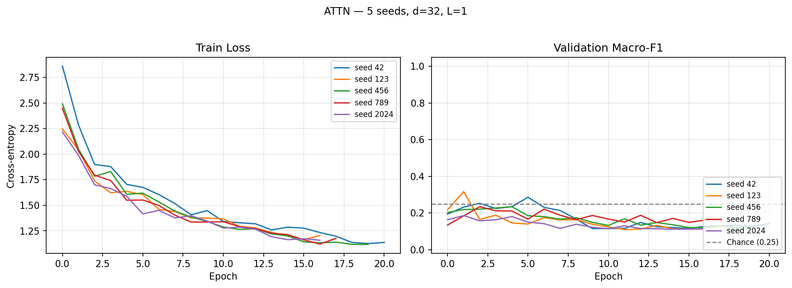

# aml2026-group-05 — Child Vocalisation Context Classification

Results and model checkpoints are saved on SwitchDrive:
- **Project data & inputs**: https://drive.switch.ch/index.php/s/c3PtXCu4gbGut9y
- **Results archive**: https://drive.switch.ch/index.php/s/NRK9nN0yo6g2n3I

---

## Problem Setting

We formulate the task as a **4-class supervised classification** problem. Each example is a short child vocalisation clip with an associated context label and limited metadata. The goal is to learn `f(x_audio, x_meta) = y` where `x_audio` is an acoustic representation, `x_meta` is `[age, gender]`, and `y ∈ {EXTEV, INTER, MOVE, PLTOY}`.

| Label | Meaning |
|---|---|
| **PLTOY** | Playing with toys |
| **MOVE** | Movement activity |
| **INTER** | Social interaction |
| **EXTEV** | External event |

---

## Dataset

| Property | Value |
|---|---|
| Total clips | 1009 |
| Class distribution | INTER=325, PLTOY=240, EXTEV=222, MOVE=222 |
| Children | 9 |
| Languages | Shipibo (313), Tagalog (414), Vietnamese (282) |
| Ages | 8–12 months, 5 unique values across 9 children |
| Gender | M/F, 2 unique values |
| Mean clip duration | 1.33 s |

**Metadata viability**: 5 unique ages and 2 unique genders across 9 children — neither is collinear with participant identity, so the metadata query in Model 3 is safe to use (`USE_EXTERNAL_META = True`).

---

## Three Models

| # | Model | Status |
|---|---|---|
| 1 | Logistic Regression (MFCC features) | ⏳ In progress |
| 2 | Audio-only Transformer (mean pooling) | ✅ Done |
| 3 | Attentive Pooling Transformer (metadata query) | ✅ Done |

**Model 2** — `input_proj(128→d)` → `TransformerEncoder(d, heads=4, L)` → masked mean pool → `Linear(d→4)`.

**Model 3** — same encoder, replaces mean pooling with metadata-query attentive pooling. Age and gender are projected to a query vector that attends over frame embeddings via unscaled dot product, with a learned temperature scalar (`log_tau`, init 0 → τ=1) before softmax.

---

## Evaluation Protocol

**Participant-disjoint holdout** with 9 children:

| Split | Child | N |
|---|---|---|
| Test | child_6 | 269 |
| Val | child_2 | 171 |
| Train | child_1, 3, 4, 5, 7, 8, 9 | 569 |

**Metric**: macro-F1 (chance = 0.25 for 4 classes).

**Multi-seed reporting**: every Transformer number is mean ± std across 5 seeds (42, 123, 456, 789, 2024). σ_seed ≈ 0.02–0.04 on this task — single-seed comparisons are dominated by noise and are not used to draw conclusions.

---

## Hyperparameter Selection

Per the problem setting, we tuned `num_layers`, `d_model`, `dropout`, and `lr` via grid search over 8 configurations, selecting on validation macro-F1.

### Model 2 — AudioTransformer grid

| d_model | layers | dropout | lr | Val F1 |
|---|---|---|---|---|
| **64** | **2** | **0.5** | **1e-3** | **0.306** ← selected |
| 64 | 2 | 0.3 | 5e-4 | 0.302 |
| 128 | 2 | 0.3 | 5e-4 | 0.300 |
| 64 | 2 | 0.3 | 1e-3 | 0.300 |
| 32 | 1 | 0.3 | 1e-3 | 0.280 |
| 128 | 3 | 0.3 | 5e-4 | 0.280 |
| 32 | 1 | 0.5 | 1e-3 | 0.279 |
| 128 | 3 | 0.5 | 5e-4 | 0.266 |

Top 4 configs are within 0.006 — all d=64, L=2. Higher dropout (0.5) gives a marginal edge.

### Model 3 — AttentivePooling grid

| d_model | layers | dropout | lr | Val F1 |
|---|---|---|---|---|
| **32** | **1** | **0.3** | **1e-3** | **0.286** ← selected |
| 128 | 3 | 0.3 | 5e-4 | 0.254 |
| 64 | 2 | 0.5 | 1e-3 | 0.250 |
| 64 | 2 | 0.3 | 1e-3 | 0.245 |
| 64 | 2 | 0.3 | 5e-4 | 0.229 |
| 32 | 1 | 0.5 | 1e-3 | 0.222 |
| 128 | 2 | 0.3 | 5e-4 | 0.219 |
| 128 | 3 | 0.5 | 5e-4 | 0.218 |

The smallest model (d=32, L=1, 26K params) won by a clear margin. The attention mechanism adds enough capacity that the encoder should be kept minimal.

---

## Project Structure

```
aml2026-group-05/
├── src/
│   ├── config.py          ← paths, hyperparameters, feature flags (USE_MFCC, USE_PER_CLIP_NORM, etc.)
│   ├── data_utils.py      ← splits, RAM-cached datasets, per-clip norm, SpecAugment, MFCC loading
│   ├── models.py          ← AudioTransformer + AttentivePoolingTransformer
│   └── train_utils.py     ← training loop (bf16 amp), evaluation, sanity checks
└── scripts/
    ├── generate_spectrograms.py
    ├── audio_to_mfccs.py             ← MFCC + Δ + ΔΔ extraction (produces 128×230 .npy files)
    ├── train_transformer_audio.py    ← Model 2 entry point + grid search
    ├── train_transformer_attn.py     ← Model 3 entry point + grid search
    ├── train_multiseed.py            ← multi-seed wrapper for Models 2 and 3
    └── train_lr_baseline.py          ← Model 1 entry point (in progress)
```

---

## Running the Models

```bash
# Generate spectrograms (run once)
python scripts/generate_spectrograms.py

# Generate MFCC features (run once, for MFCC ablation)
python scripts/audio_to_mfccs.py

# Grid search (selects best config on val F1)
python scripts/train_transformer_audio.py --grid_search --use_existing_splits
python scripts/train_transformer_attn.py  --grid_search --use_existing_splits

# Final multi-seed runs with grid-selected configs (mel spectrograms)
python scripts/train_multiseed.py --model audio --seeds 42 123 456 789 2024 --use_existing_splits \
    --d_model 64 --num_layers 2 --dropout 0.5 --lr 0.001 --batch_size 32
python scripts/train_multiseed.py --model attn --seeds 42 123 456 789 2024 --use_existing_splits \
    --d_model 32 --num_layers 1 --dropout 0.3 --lr 0.001 --batch_size 16

# MFCC ablation: set USE_MFCC=True in config.py, then run the same commands above
```

Hardware: NVIDIA A10 (8 GB) with PyTorch 2.4 + CUDA 12.1, bf16 mixed precision.

---

## Results

**Protocol**: participant-disjoint holdout. All Transformer numbers are mean ± std across 5 seeds. Chance = 0.25.

### Final reported numbers (grid-selected hyperparameters, mel spectrograms)

| Model | Config | Params | Val F1 | Test F1 |
|---|---|---|---|---|
| 1 — Logistic Regression | TBD | TBD | TBD | TBD |
| **2 — Audio Transformer** | d=64, L=2, drop=0.5 | 126K | 0.270 ± 0.022 | **0.249 ± 0.020** |
| **3 — Attentive Pooling** | d=32, L=1, drop=0.3 | 26K | 0.252 ± 0.045 | **0.221 ± 0.013** |
| Chance | — | — | 0.250 | 0.250 |

**Δ Model 2 vs Model 3**: +0.028, pooled σ ≈ 0.024, |Δ|/σ ≈ 1.2 — within noise. The two architectures are statistically indistinguishable.

> **Interpretation**: After grid-based hyperparameter tuning, Model 2 lands exactly at chance (0.249 vs 0.250) and Model 3 slightly below. Neither architecture has learned class-discriminative features that generalise from the 7 training children to the unseen test child. The grid search explored 26K–648K parameters and found no configuration that meaningfully exceeds chance.

---

### Ablation 1 — Preprocessing (per-clip norm + SpecAugment)

Using the default preset (d=64, L=2, drop=0.3) to isolate the effect of preprocessing:

| Model | Preprocessing | Val F1 | Test F1 | Val→Test gap |
|---|---|---|---|---|
| 2 — Audio Transformer | raw | 0.224 ± 0.008 | 0.231 ± 0.027 | −0.003 |
| 2 — Audio Transformer | norm + SpecAugment | 0.288 ± 0.017 | 0.228 ± 0.007 | +0.060 |
| 3 — Attentive Pooling | raw | 0.227 ± 0.022 | 0.224 ± 0.027 | +0.003 |
| 3 — Attentive Pooling | norm + SpecAugment | 0.239 ± 0.028 | 0.213 ± 0.025 | +0.026 |

> **Interpretation**: Preprocessing lifted Model 2 val F1 by +0.064 and tightened seed-to-seed variance, but test F1 did not move (0.231 → 0.228). The val→test gap widened from ≈0 to +0.06. This is direct evidence that the bottleneck is **inter-child variance**, not input quality. The model fits the validation child more accurately with better preprocessing, but those improvements do not transfer to the different test child.

---

### Ablation 2 — Input features (MFCC + Δ + ΔΔ vs mel spectrogram)

MFCCs apply a decorrelating cosine transform to the mel spectrum, which partially removes the spectral envelope encoding speaker identity. We tested whether this speaker-normalising property would improve cross-participant generalisation. Using grid-selected configs with preprocessing enabled:

| Model | Features | Test F1 |
|---|---|---|
| 2 — Audio Transformer | mel spectrogram | 0.249 ± 0.020 |
| 2 — Audio Transformer | MFCC + Δ + ΔΔ | 0.238 ± 0.039 |
| 3 — Attentive Pooling | mel spectrogram | 0.221 ± 0.013 |
| 3 — Attentive Pooling | MFCC + Δ + ΔΔ | 0.237 ± 0.026 |

> **Interpretation**: MFCCs did not improve test F1 for either model. Both MFCC conditions land at ~0.24, statistically indistinguishable from mel spectrograms and from chance. Notably, MFCCs increased seed-to-seed variance for Model 2 (σ: 0.020 → 0.039), making training less stable without improving the mean. The speaker-normalisation hypothesis — that decorrelating the spectral envelope would help cross-participant generalisation — did not hold at this data scale. This rules out the last plausible in-scope lever: the ceiling is data-imposed, not feature-imposed.

---

### Per-class TEST macro-F1 (grid-selected configs, mel spectrograms)

| Class | Model 2 | Model 3 |
|---|---|---|
| EXTEV | 0.194 ± 0.072 | 0.147 ± 0.043 |
| INTER | 0.401 ± 0.021 | 0.318 ± 0.044 |
| MOVE | 0.220 ± 0.074 | 0.093 ± 0.045 |
| PLTOY | 0.183 ± 0.084 | 0.326 ± 0.036 |

> **Interpretation**: INTER is the strongest class for both models — it is the largest training class and likely has the most consistent acoustic signature. EXTEV and MOVE are the weakest: EXTEV covers reactions to diverse external stimuli with no consistent vocalisation pattern, and MOVE spans different physical activities. The two models fail on different classes (Model 2 is weakest on PLTOY, Model 3 on MOVE), but neither achieves reliable per-class performance.

---

### Training curves (grid-selected configs, 5 seeds)

<p align="center">
  
  
</p>

<p align="center">
  <strong>Left:</strong> Model 2 (d=64, L=2, drop=0.5) &nbsp;&nbsp;
  <strong>Right:</strong> Model 3 (d=32, L=1, drop=0.3)
</p>

> **Interpretation**: Model 2 trains for 25–53 epochs; train loss drops steadily while val F1 oscillates around chance — classic overfitting without generalisation. Model 3 early-stops within 16–21 epochs; val F1 peaks in the first 2–6 epochs and then degrades. The tiny encoder (d=32, L=1) converges fast and then drifts. Neither model finds a training regime where continued optimisation improves cross-participant performance.

---

### Test confusion matrices (grid-selected configs, 5 seeds)

<p align="center">
  
  
</p>

<p align="center">
  <strong>Left:</strong> Model 2 &nbsp;&nbsp;&nbsp;
  <strong>Right:</strong> Model 3
</p>

> **Interpretation**: Model 2 collapses heavily onto INTER — predicting it for the majority of EXTEV, INTER, and PLTOY examples. Model 3 distributes predictions more evenly but remains biased toward PLTOY. Neither matrix shows a strong diagonal, confirming that neither model has learned class-specific features that survive the participant shift.

---

## Summary of all approaches

| Approach | What we tried | Test F1 | Did it help? |
|---|---|---|---|
| Architecture comparison | Mean pool (M2) vs attentive pool (M3) | 0.249 vs 0.221 | No — indistinguishable (|Δ|/σ ≈ 1.2) |
| Hyperparameter tuning | Grid search over d_model, layers, dropout, lr | 0.249 (best) | No — no config exceeded chance |
| Preprocessing | Per-clip norm + SpecAugment | 0.228 | No — helped val (+0.06) but not test |
| Input features | MFCC + Δ + ΔΔ instead of mel spectrogram | 0.238 | No — within noise of mel baseline |
| Model capacity | 26K → 648K parameters | all ≈ 0.22–0.25 | No — not capacity-limited |

**Every lever we pulled landed at the same place: ~0.24 ± 0.03 on test, indistinguishable from chance.** The consistent finding across all approaches is that inter-child variance is the dominant source of test error, and no from-scratch method at this data scale can overcome it.

---

## Key Design Decisions

**Evaluation protocol** — The 9 children contributed very uneven amounts of data (11 to 269 clips each), so an exact 70/15/15 split by clip count was not achievable under the participant-disjoint constraint. The two largest and most class-balanced children were assigned to test and val, yielding a 56/17/27 clip-count ratio. The deviation is justified: any participant-disjoint split of 9 unequal-sized children cannot exactly match the target ratio, and using smaller children for held-out splits would risk missing entire classes.

**Macro-F1 metric** — equally penalises poor recall on any class. Accuracy would be misleading because predicting INTER for everything yields ~30% accuracy.

**No child ID as feature** — direct identity creates leakage and violates participant privacy. Age and gender are used instead, verified non-collinear with identity.

**Multi-seed reporting (n=5)** — every Transformer result is mean ± std across 5 seeds. Single-seed comparisons on n_test = 269 are dominated by sampling noise.

**Hyperparameter selection on val only** — the grid search ranked 8 configurations by val macro-F1. The grid-selected config was then retrained with 5 seeds for the final reported test number. Test was not used for model selection.

**Input feature toggle** — `USE_MFCC` in `config.py` switches between mel spectrograms (default, spec-compliant) and MFCC + Δ + ΔΔ features. Both produce identical (128, 230) tensors so no other code changes are needed.

**Grayscale spectrograms from denoised audio** — clean acoustic content only (no axes or colorbar pixels). Native mel resolution (128 mel bins × T frames), resized to 128 × 230 inside the dataset.

**bf16 mixed precision on GPU** — bf16 has fp32 dynamic range (no GradScaler needed), ~1.5–2× throughput on the A10.

**RAM-cached inputs** — entire dataset (~120 MB) preloaded at dataset construction. Zero per-epoch file I/O.

---

## Next Steps

Our results show that the performance ceiling is imposed by inter-child variance and data scale, not by model architecture, hyperparameters, preprocessing, or input features. The following directions target that bottleneck directly.

### 1. Pretrained audio embeddings

The single highest-leverage change. Models like wav2vec2, PANNs (CNN14), or YAMNet have learned speaker-invariant acoustic representations from hundreds of thousands of hours of diverse audio. Replacing our from-scratch encoder with frozen pretrained embeddings would give the classifier access to features that are already robust to speaker variation. We would cache embeddings once per clip and train only the pooling + classifier head, keeping the Model 2 vs Model 3 comparison intact. Based on the literature, we expect this to lift test F1 from ~0.25 to the 0.40–0.55 range — high enough to actually resolve the architectural comparison.

### 2. Cross-participant augmentation

Our current augmentation (SpecAugment) operates within each clip independently. A more targeted approach would augment across participants — mixing spectrograms from different children within the same class (mixup) or applying pitch/formant perturbation to simulate speaker variability. This addresses the bottleneck more directly than SpecAugment, which only adds within-clip noise.

### 3. Leave-one-participant-out (LOPO) evaluation

LOPO cross-validation across all 9 children would provide a more robust estimate of cross-participant generalisation. Each fold holds out one child for test, averaging out the idiosyncrasy of any single test child. This would not improve the model but would produce a fairer performance estimate and reveal whether the near-chance result is specific to child_6 or universal.
